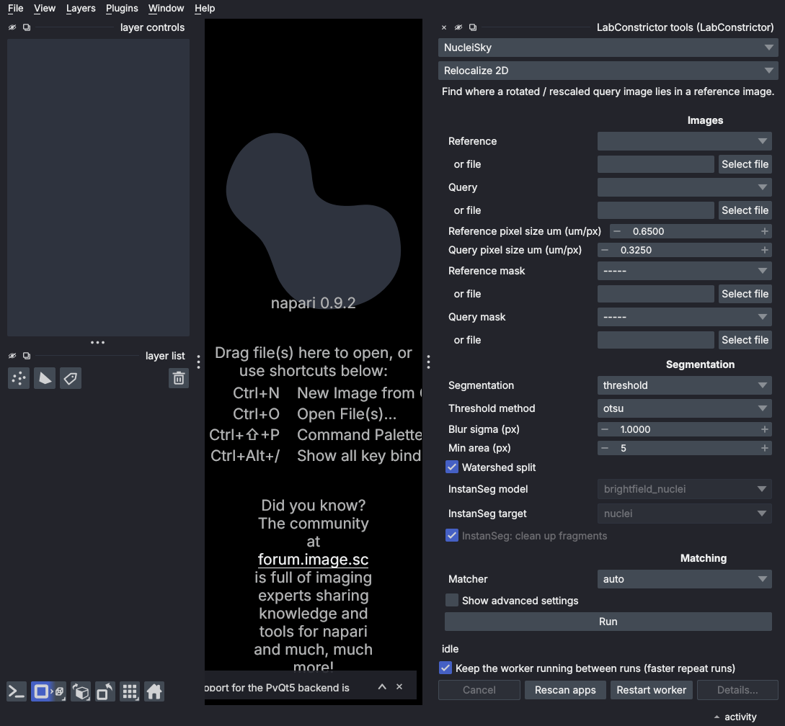

# LabConstrictor Tools

**Write a Python analysis once. Use it in napari, Fiji, QuPath, a notebook or the command line.**

A [LabConstrictor](https://github.com/CellMigrationLab/LabConstrictor) app can offer **tools**: Python functions with typed inputs and outputs. LabConstrictor Tools is the small Python package every app carries. It describes each tool so that a plugin can build a form for it, run it in the app's own Python environment, and put the results back into your image software.



**Documentation: <https://cellmigrationlab.github.io/LabConstrictor-Tools/>** · Website and apps: <https://cellmigrationlab.github.io/LabConstrictor-Site/>

## Who is it for?

- **You use an app** and want its tools inside napari, Fiji or QuPath. Start with [Use apps in napari, Fiji and QuPath](https://cellmigrationlab.github.io/LabConstrictor-Tools/user-guide/) and [What works where](https://cellmigrationlab.github.io/LabConstrictor-Tools/CAPABILITIES/).
- **You make an app** and want its functions to appear in every host without writing interface code. Start with [Writing tools](https://cellmigrationlab.github.io/LabConstrictor-Tools/AUTHORING/).

You do not install this package yourself to use an app: the app's installer brings it.

## Try it

1. Install the [LabConstrictor Playground](https://github.com/CellMigrationLab/LabConstrictor-Playground/releases) app. It makes its own test image, so you need no data.
2. Install the plugin for your software: [napari](https://github.com/CellMigrationLab/LabConstrictor-napari), [Fiji](https://github.com/CellMigrationLab/LabConstrictor-Fiji) or [QuPath](https://github.com/CellMigrationLab/LabConstrictor-QuPath). The steps for all three are on [one page](https://cellmigrationlab.github.io/LabConstrictor-Tools/INSTALL/).
3. Open the plugin, pick **Playground** and run **Feature tour**. It returns a label image, outlines, points, a table and a message.

## Write a tool

```python
from typing import Annotated
from labconstrictor_tools import Image, ImageOut, Min, tool

@tool("Gaussian blur")
def blur(image: Image, sigma: Annotated[float, Min(0)] = 2.0) -> ImageOut:
    from skimage.filters import gaussian
    return gaussian(image, sigma, preserve_range=True)
```

That is the whole declaration: an image input, a number that cannot be negative, and an image result. Every host builds its form from it. Check and test your tools with:

```bash
labconstrictor-tools check --module myapp_lc_tools --pythonpath .
labconstrictor-tools test  --module myapp_lc_tools --pythonpath .
```

Tools run from the command line too:

```bash
labconstrictor-tools list
labconstrictor-tools run myapp blur image=cells.tif sigma=3 --out results/
```

## How it works

1. An app declares tools. Its installer registers them on your computer.
2. A plugin reads the registered descriptions and builds a form. It never imports the app's packages.
3. When you press Run, the tool runs in a separate process, in the app's own Python. Apps with conflicting packages can sit side by side.
4. Results come back as files (TIFF, CSV, GeoJSON) and the plugin shows them.

The separate process is **not a security sandbox**. Install and run only apps you trust.

## Status

Alpha. Current releases: Tools `v0.3.0-alpha.2`, napari plugin `v0.1.0-alpha.5`, Fiji and QuPath plugins `v0.1.0-alpha.7`. Automated tests run on Linux, Windows and macOS; people have used it on Linux only so far. The details are in [What works where](https://cellmigrationlab.github.io/LabConstrictor-Tools/CAPABILITIES/).

Found a problem? [Open an issue](https://github.com/CellMigrationLab/LabConstrictor-Tools/issues) with the host, the operating system, the app and the steps.

## Install the package on its own

Only needed for development, or to add Tools to an environment by hand. Nothing is on PyPI yet:

```bash
python -m pip install https://github.com/CellMigrationLab/LabConstrictor-Tools/archive/refs/tags/v0.3.0-alpha.2.zip
```

## Development

```bash
python -m pip install -e ".[test]" black ruff mypy
black --check .
ruff check .
python scripts/check_annotations.py
mypy
cd tests && python -m unittest discover -p "test_*.py"
```

The test suites are described in [tests/README.md](tests/README.md) and in [Automated testing](https://cellmigrationlab.github.io/LabConstrictor-Tools/TESTING/).

License: MIT.
