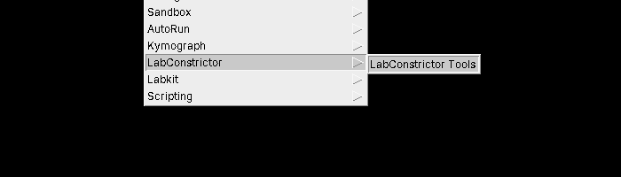
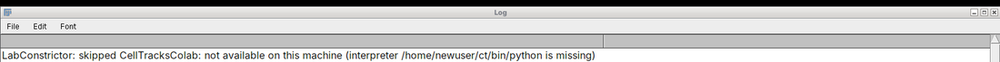

# Human test protocol: LabConstrictor apps in Napari, Fiji and QuPath

**Purpose.** Check, by hand and on a real computer, that the LabConstrictor apps install, register their tools, show up in the hosts that
are meant to show them (and in no other), run there, and fail in an understandable way when something is wrong.

**Who.** Anyone who can install a program and use Napari, Fiji or QuPath. No programming is needed; a few steps type one command into a terminal.

**How long.** The *Quick path* below is about 45 minutes per operating system. Everything is several hours: do the parts you were asked for.

**What this replaces.** `docs/TESTING_PROMPT.md` is a prompt for an AI agent that tests from source; this file is the one for people.
The automated counterpart is the release sandbox ([TESTING.md](TESTING.md#release-sandbox-a-released-app-on-fresh-runners)): it tests a
released app on fresh runners, but only Napari for most apps and Fiji/QuPath only for the Playground, and no human look at a screen.

**How to install** the apps and the hosts: [INSTALL.md](INSTALL.md) (the one install page; section 2 and N0/F0/Q0 below repeat what a tester needs and are the test steps).

## How this protocol is split

| File | Content |
|---|---|
| this file | the **test-set record sheet**, the install rules, the discovery matrix, set-up of the hosts, tests that do not depend on an app (install, listing, errors, uninstall), the report |
| [human_tests/nucleisky.md](human_tests/nucleisky.md) | NucleiSky in Napari, Fiji and QuPath (the long case set: values you can check) |
| [human_tests/playground.md](human_tests/playground.md) | Playground: the diagnostic readout and every bridge feature in the three hosts |
| [human_tests/guessthecondition.md](human_tests/guessthecondition.md) | Guess the Condition (a game played tool by tool) in the three hosts |
| [human_tests/vlab4mic.md](human_tests/vlab4mic.md) | VLab4Mic in Napari and Fiji (and its absence from QuPath) |
| [human_tests/celltrackscolab.md](human_tests/celltrackscolab.md) | CellTracksColab: a notebook app, which no host shows |

## How to use this document
1. Copy this file and the case file of each app you test (or paste them into a GitHub issue: the boxes then become clickable). Print them if you prefer paper.
2. Fill in the **Record sheet** (section 0). **Every result is tied to the versions in it**: a result without a filled record sheet cannot be used.
3. Do the sections in order. Each test has **Do**, **Expect** and three boxes. Tick exactly one:
   * `PASS`: what you see matches **Expect**.
   * `FAIL`: it differs. Write what you saw in *Notes*, and take a screenshot.
   * `N/A`: you could not do the step (say why; "no Windows machine" is a valid reason).
4. Do not skip a failing test: note it and continue, unless the test says **STOP**.
5. At the end, send the record sheet, the screenshots and a support bundle (test E4).

**Statements marked "not verified"** are things the authors of this protocol could not check themselves. If you see something different, that is a finding: write it down, it is not a mistake of yours.

**Quick path.** S1 to S4, D1 to D3, N0/F0/Q0 for the hosts you were asked to test, then in each app file the first three tests of each host
(listing, one normal run, one error). Everything else is the full protocol.

**Severity** (use it when you write a FAIL):

| Level | Meaning |
|---|---|
| Blocker | cannot install, cannot start, data lost, or a wrong scientific result **without any warning** |
| Major | a feature does not work, or an error is shown but nobody could understand it |
| Minor | works, but confusing, slow, or a wrong label |
| Cosmetic | spelling, alignment |

**Words used.** *App* = a LabConstrictor installer program. *Tool* = one function of an app that appears in a host. *Host* = Napari, Fiji or
QuPath. *Registry* = the folder where installed apps announce themselves. *Prefix* = the folder you chose when installing the app.
*Test set* = the exact versions of everything in the record sheet.

---

## 0. Record sheet: the test set (fill in before you start)

### 0.1 The test set (the maintainer fills this in before the round; testers copy it)
Testers install **only this set** and only the **latest** of each item: an older release or a branch is not a test of this round. If a
row below still says `<fill in>`, the set is not ready: do not start. (Why exact versions: an installed app carries the Tools it was built
with; hosts refuse an app whose Tools is too old; a result is meaningless without knowing which pieces met.)

| Item | Value | Download link (exact) |
|---|---|---|
| Tools tag | `v0.3.0-alpha.1` (Python version `0.3.0a1`); commit `<fill in>` | https://github.com/CellMigrationLab/LabConstrictor-Tools/releases/tag/v0.3.0-alpha.1 (the tag is created by the maintainer: until it exists the apps cannot install) |
| Template version of the apps | `<fill in>` (apps are on 0.1.17 today; 0.1.18 is a template pull request that is not merged: not verified which one the releases below carry; read `.template_sync/manifest.yaml` of the release tag) | n/a |
| Napari plugin tag | `<fill in>` (the plugin had no tag when this was written) | `https://github.com/CellMigrationLab/LabConstrictor-napari/archive/refs/tags/<NAPARI_TAG>.zip` |
| Fiji plugin tag | `<fill in>`; file `labconstrictor-fiji-<tag>.jar` (and `labconstrictor-fiji-script-<tag>.zip`, `SHA256SUMS`) | `https://github.com/CellMigrationLab/LabConstrictor-Fiji/releases` (no release existed when this was written: not verified) |
| QuPath plugin tag | `<fill in>`; file `labconstrictor-qupath-<tag>.jar` (and `LabConstrictorTools-all.groovy`, `SHA256SUMS`) | `https://github.com/CellMigrationLab/LabConstrictor-QuPath/releases` (no release existed when this was written: not verified) |
| Napari / Fiji / QuPath themselves | Napari `<fill in>` (Python 3.11 or newer); Fiji `<fill in>` (Java build: ask); QuPath **0.7.0** (the plugin is built against it, other versions are not supported) | https://napari.org, https://fiji.sc, https://qupath.github.io |
| NucleiSky | planned **0.1.4** (pin pull request #38); `<fill in>` | https://github.com/CellMigrationLab/NucleiSky/releases |
| Playground | planned **0.0.4** (pin pull request #27); `<fill in>` | https://github.com/CellMigrationLab/LabConstrictor-Playground/releases |
| VLab4Mic | proposed 0.1.6, to be confirmed (pin pull request #17); `<fill in>` | https://github.com/CellMigrationLab/LabConstrictor-VLab4Mic/releases |
| Guess the Condition | proposed 0.0.1, to be confirmed (pin pull request #14; the app is at 0.0.0 today); `<fill in>` | https://github.com/CellMigrationLab/GuessTheCondition/releases |
| CellTracksColab | latest release (1.1.1 when this was written; no new release is planned before the bridge decision); notebook app only | https://github.com/CellMigrationLab/CellTracksColab/releases |
| Installer file names (per app, per OS) | `<fill in>` | |

The "planned" numbers are the next free release numbers of each app after its pin pull request: the table must be corrected to what was
really published. The pins in the apps are `v0.2.0-rc.1` today and become `v0.3.0-alpha.1` only after the pin pull requests are merged and the apps
are released ([OPERATIONS.md](OPERATIONS.md#pinning-tools-in-app-installers)); an app release that still pins `v0.2.0-rc.1` is **not** part of this
test set (Fiji and QuPath leave it out of their lists with a sentence in the Log: that is correct behaviour; what Napari does with it is not verified, see D4).

### 0.2 The tester and the computer
| Field | Your entry |
|---|---|
| Tester name and date | |
| Operating system and version (e.g. Windows 11 23H2, macOS 14.5 Apple silicon (Intel Macs are not supported), Ubuntu 24.04) | |
| RAM; a managed/office computer with antivirus or admin restrictions? Behind a proxy or firewall? Admin rights? | |
| Does your user name or the folder you will install into contain a space? (see S0) | |
| Napari: version, Python version, Qt backend (`pip list`), how it was installed | |
| Fiji: version (Help > About ImageJ), jar or script install | |
| QuPath: version (Help > About), jar or script install | |
| Was LabConstrictor installed on this computer before? (existing apps, existing `.labconstrictor` folder) | |
| Prefix (install folder) of each app you installed | |

---

## 1. What you need
- [ ] A computer with the operating system you will report on: Windows, Linux, or a Mac with Apple silicon. **Intel Macs are not supported** (some required packages no longer ship Intel Mac builds; if you only have an Intel Mac, tell us instead of testing; four app repositories still build an Intel installer, which is not a promise that it works: not verified). At least 25 GB of free disk space for NucleiSky and Playground (PyTorch: about 9 GB installed, about 5 GB of download caches).
- [ ] Internet access during installation (the installers download packages) and for the tests that say so.
- [ ] The installers of the apps in the record sheet for your system, from the exact links there.
- [ ] For the hosts you test: Napari in a Python 3.11+ environment you may modify (a fresh one is better); Fiji ("Fiji with Java"), a fresh unzipped copy if you can; QuPath 0.7.0.
- [ ] A screenshot tool, a text editor, and this document.

**Which Python.** Each app has its own Python. The commands below start it by its full path:

| | Linux / macOS (terminal) | Windows (PowerShell) |
|---|---|---|
| `<APP_PY>` of the app installed in `<PREFIX>` | `<PREFIX>/bin/python` | `& "<PREFIX>\python.exe"` |

In every command `<APP_PY>` stands for that line, typed in full (in PowerShell the `&` and the quotes are needed; in `cmd.exe` leave out the `&`).
Nothing in `<...>` is a variable your terminal understands: type the real folder.

**Where things are**
| What | Linux / macOS | Windows |
|---|---|---|
| Registry folder (do not delete) | `~/.labconstrictor/apps` | `%USERPROFILE%\.labconstrictor\apps` |
| Log file | `~/.labconstrictor/logs/labconstrictor.log` | `%USERPROFILE%\.labconstrictor\logs\labconstrictor.log` |
| Installer log of an app | `<PREFIX>/menuinst_debug.log` | `<PREFIX>\menuinst_debug.log` |
| Run records | `~/.labconstrictor/runs/` | `%USERPROFILE%\.labconstrictor\runs\` |
| Results of command-line runs | `~/.labconstrictor/results/` | `%USERPROFILE%\.labconstrictor\results\` |

---

## 2. Install rules (read before S1)
1. **No space anywhere in the install path.** The installers refuse a destination folder that contains a space (the installer builder's
   default `check_path_spaces`, kept on purpose). If your Windows user name contains a space, the installer's default folder contains one too
   and is refused: choose a folder such as `C:\LabConstrictor\<app>` (Windows) or `~/labconstrictor/<app>` (macOS, Linux). Test W1 checks the refusal.
2. **Updating.** macOS and Windows: uninstall the old version first, then install the new one (the installer does not install over an existing install).
   Linux: `bash <installer>.sh -u -p <PREFIX>` updates in place **only if the previous install finished**; after a failed or interrupted install delete
   `<PREFIX>/pkgs` (or uninstall and install again), otherwise the update breaks. (Source: OPERATIONS and TESTING pages of this repository, from the
   sandbox findings of 13 Oct; the template's own install page for this is in an unmerged pull request, template #33.)
3. **Tagged installs only.** Install exactly the tagged things in the record sheet. Never `main.zip`, never a branch archive, never
   `pip install` of Tools from `main`. The apps install Tools from a pinned tag (`LC_TOOLS_PIN` in their `post_install` hooks); the Napari line below pins the Tools tag
   and the plugin tag.
4. **Only the latest.** Do not test an older release "to compare". If you already have an older app, uninstall it first (rule 2), or say so in the record sheet.

---

## 3. Which host shows which app (the discovery matrix)
This is the **decided rule**; it is the binding rule in Tools (feature `app_hosts_v1`, Tools PR #133, merged); the three hosts honour it (merged: Napari #61, Fiji #47,
QuPath #35; no host has a tag yet) and installers pass it from template 0.1.18 (template PR #33, not merged). Check the Tools tag, the host versions and the installer of your test set.
An app installed by an older installer has no declaration and every host lists it, logging the 'declares no hosts' sentence ([REPOSITORIES.md](REPOSITORIES.md)); the tests D1 to D3 are written for the rule.
discovery rule: see PROTOCOL.md, section "App hosts (which host lists an app)"

| App | Napari | Fiji | QuPath | Notebook (the app's own window) |
|---|---|---|---|---|
| NucleiSky | listed | listed | listed | yes |
| Guess the Condition | listed | listed | listed | yes |
| Playground | listed | listed | listed | yes |
| VLab4Mic | listed | listed | **not listed** | yes |
| CellTracksColab | **hidden** | **hidden** | **hidden** | yes (notebook only) |

"Hidden" and "not listed" mean the same for you: the app is not in the application drop-down, and nothing is broken. The release sandbox
tests CellTracksColab as "must be hidden" (it registers a tool there on purpose, so that hiding is what is tested); on the installer you test
it may register no tool at all, which hides it trivially.

---

## 4. Install and registration

### S0. The path
**Do:** choose, for each app, a prefix without a space (rule 1) and write it in the record sheet. Windows: do not use the default folder if your user name has a space.

- [ ] PASS  - [ ] FAIL  - [ ] N/A   Notes: ______________________________

### S1. Install an app
**Do:** run the installer of the app you test (Linux batch example: `bash NucleiSky-<version>-Linux-x86_64.sh -b -p <PREFIX>`; use the file of
your system, never the Linux file on a Mac). This takes several minutes (6 to 8 for a small app; PyTorch apps longer): the window may look idle.

**Expect:** the installer finishes without an error message. `<PREFIX>/menuinst_debug.log` exists and its last line is `Post-install completed successfully.`

- [ ] PASS  - [ ] FAIL  - [ ] N/A   Notes: ______________________________

### S2. The tools were registered during installation
**Do:** open `menuinst_debug.log`, search for `lc_tools`. (The installer downloads the small *labconstrictor-tools* package from GitHub, so it needs internet at that moment: the log shows
`Successfully installed labconstrictor-tools-...`; the version must be `0.3.0a1`.) Then run `<APP_PY> -m labconstrictor_tools list`.
* Linux/macOS: expect `Found <package>_lc_tools: registering the tools of <App> ...` and `Tools registered (labconstrictor-tools list shows them).`
* Windows: expect `Found <package>_lc_tools: registering ...` followed by a block of text containing `"schema_path"`. (The Windows script does not print "Tools registered".)
* Neither: no line starting with `WARNING: tool registration failed`.

**Expect:** `list` shows the app at the release version with its tools (the case file of the app names them). **CellTracksColab:** no such lines and no entry in `list` is expected (see its case file).

- [ ] PASS  - [ ] FAIL  - [ ] N/A   Notes: ______________________________

### S3. Diagnose
**Do:** `<APP_PY> -m labconstrictor_tools doctor`.

**Expect:** one line per registered app starting with a check mark, no line starting with a cross; the last lines name the registry folder and the log file.

- [ ] PASS  - [ ] FAIL  - [ ] N/A   Notes: ______________________________

### S4. Nothing unexpected was installed or written
**Do:** look in your home folder.

**Expect:** the only new **LabConstrictor** folder is `.labconstrictor` (registry, logs, runs). The installer may also create menu entries (on Linux under `~/.local/share/applications` and `~/.local/share/desktop-directories`) and the folders of the tools it uses (`~/.conda`, `~/.mamba`, `~/.cache`, `~/.config`, `~/.local/share/mime`, dated backups of `~/.config/menus/applications.menu`; later `~/.imagej`, `~/.java` from Fiji): normal. No error dialogs. No administrator rights needed unless you chose a protected folder.

- [ ] PASS  - [ ] FAIL  - [ ] N/A   Notes: ______________________________

### C1. Run a tool without any window (optional)
**Do:** `<APP_PY> -m labconstrictor_tools run <App> <tool id> name=value ...` for a tool of the app (the case file gives one, with its tool id).

**Expect:** a JSON report with `"status": "COMPLETE"` and a last line `(results are in ...results/<time>_<id>_<App>_<tool> - ...; the newest 20 runs are kept)` (it goes to the error stream: with a pipe it can appear before the JSON; not a failure). A wrong input gives `"status": "FAILED"` with a `code` and a sentence an ordinary person can read.

- [ ] PASS  - [ ] FAIL  - [ ] N/A   Notes: ______________________________

---

## 5. The three hosts: set-up (once per host)

### N0. Napari
**Do:** create a fresh environment (Linux/macOS shown; Windows PowerShell: `.\napari-env\Scripts\Activate.ps1`, or `cmd.exe`: `napari-env\Scripts\activate.bat`; if PowerShell says
"execution of scripts is disabled" that is a setting of your computer: note it and use cmd.exe) and install **with a Qt6 backend**:
```
python -m venv napari-env
source napari-env/bin/activate
pip install "napari[pyqt6]" https://github.com/CellMigrationLab/LabConstrictor-Tools/archive/refs/tags/v0.3.0-alpha.1.zip https://github.com/CellMigrationLab/LabConstrictor-napari/archive/refs/tags/<NAPARI_TAG>.zip
napari
```
Use `napari[pyqt6]` (PySide6 is the other tested backend, `napari[pyside6]`); **not** `napari[pyqt5]`: the plugin's README says PyQt5 is not tested and napari deprecated it in 0.8.0. The two long addresses are source archives of tags: no `git` program is needed; replace `<NAPARI_TAG>` by the tag in the record sheet.

**Expect:** Napari opens. `Plugins` contains **LabConstrictor tools**. There is no backend notice (a PyQt5 notice would mean the wrong install). On a bare Linux system a Qt error `Could not load the Qt platform plugin "xcb"` means missing `libxcb-*` packages: a computer set-up problem, not a LabConstrictor one.

- [ ] PASS  - [ ] FAIL  - [ ] N/A   Notes (Qt backend you have): ______________________________

### F0. Fiji
**Do (jar, preferred):** download `labconstrictor-fiji-<tag>.jar` from the Fiji release of the record sheet, put it into `Fiji.app/plugins/` (not a subfolder; remove any older `labconstrictor-fiji-*.jar`), restart Fiji. Menu entry: **Plugins > LabConstrictor > LabConstrictor Tools...**. Check the file against `SHA256SUMS` of the release if you can.
**Alternative (no jar):** download `labconstrictor-fiji-script-<tag>.zip` and unzip it so that **both** the script `LabConstrictor_Tools.groovy` **and its `lib` folder** sit in `Fiji.app/scripts/Plugins/LabConstrictor/` (the script alone stops with a message); the entry is **Plugins > LabConstrictor > LabConstrictor Tools** (no dots; Fiji also lists the `lib` helper files in the menu: harmless). **Macro calls need the jar.** Do not install both (the tool would be listed twice). Write down which one you used.

**Expect:** after restart the menu entry exists (if you cannot find it, type `LabConstrictor` into Fiji's search bar, press *Run*, and note it as a FAIL of this test).

- [ ] PASS  - [ ] FAIL  - [ ] N/A   Menu path you used: ______________________________

*What it should look like:* 

**Fiji limits (known; do not report them as bugs, but do check that they behave as stated):**
* A pixel-size field linked to an image follows the image's calibration by itself, until you type a value. There is **no "use the image's calibration" button**.
* If you type the very value the box already shows, Fiji cannot see that as an edit (conformance case CAL-T9, "undetectable in a SciJava dialog"): the field is **cleared and the run is blocked with a message**; a wrong value is never sent. Type a different value, or re-select the image.
* Fields that do not apply (`EnabledWhen`) are **not** greyed out; a folded group (`Collapsed`) is a plain heading. Nothing is lost.
* Fiji starts a new worker for each run (about 12 s with NucleiSky); there is no kept worker.
(Source: `LabConstrictor-Fiji` README, "Known limits of the pixel-size field", and [HOST_FEATURES.md](HOST_FEATURES.md).)

### Q0. QuPath
**Do (jar, preferred):** install QuPath **0.7.0** (QuPath 0.7 is built with Java 25 and the jar needs it; older QuPath versions are not supported). Download `labconstrictor-qupath-<tag>.jar` from the QuPath release of the record sheet, drag it onto the QuPath window (or copy it into the extensions folder shown in QuPath's Preferences), restart QuPath.
**Alternative (Script Editor):** download the **single file** `LabConstrictorTools-all.groovy` from the same release, open it in QuPath's Script Editor (`Automate > Show script editor`) and run it. The repository's source script is split into several part files joined by the build; **the parts are not usable in the Script Editor**, only the all-in-one file from the release (the jar joins the parts itself). Write down which one you used.

**Expect:** **Extensions > LabConstrictor tools...** exists. With no app registered the window says "No LabConstrictor app is registered on this machine" (install an app, press **Rescan apps**).

- [ ] PASS  - [ ] FAIL  - [ ] N/A   Notes: ______________________________

*Not verified:* the drag-and-drop install of a released jar (the release smoke test puts the jar on the class path), and any QuPath step on Windows or macOS by a person.

---

## 6. Discovery: who shows which app

### D1. The list in each host, for each installed app
**Do:** with the apps of your test set installed, open the application list: Napari `Plugins > LabConstrictor tools` (first drop-down; **Rescan apps** after installing); Fiji the *Application* drop-down of the plugin dialog (with a single usable app the dialog is skipped and the tool form opens directly);
QuPath `Extensions > LabConstrictor tools...` (app chooser).

**Expect:** the list equals the matrix of section 3 for the apps you installed (hosts you did not set up: N/A). Fill the table with L (listed), - (not listed):

| App | Napari | Fiji | QuPath |
|---|---|---|---|
| NucleiSky | | | |
| Guess the Condition | | | |
| Playground | | | |
| VLab4Mic | | | |
| CellTracksColab | | | |

A mismatch is a **Major** FAIL (an app that must be hidden is shown, or one that must be listed is missing); write the host, app, and what the Log or status line says.

- [ ] PASS  - [ ] FAIL  - [ ] N/A   Notes: ______________________________

### D2. VLab4Mic is not offered in QuPath
**Do:** install VLab4Mic. Open QuPath's app chooser. Press **Rescan apps**.
**Expect:** VLab4Mic is not there, while it is in Napari and Fiji; the other apps are unaffected. The host writes `'VLab4Mic' is not listed in qupath: the app declares hosts: notebook, napari, fiji` to the Tools log (`<LC_HOME>/logs/labconstrictor.log`) and shows it wherever it reports left-out apps. The hosts honour the rule; what is still future is the declaration: it exists only once the installers pass `--app-manifest` (template 0.1.18 and the app sync are not merged yet), so this is not verified until the apps are re-installed with an installer that passes the hosts. For an app registered by an installer that passes no hosts the sentence is `'<app>' declares no hosts, so it is listed in every host; register it with --app-manifest (or --hosts) to choose`, and the app is then listed in every host.

- [ ] PASS  - [ ] FAIL  - [ ] N/A   Notes: ______________________________

### D3. CellTracksColab is offered nowhere
**Do:** install CellTracksColab next to another app. Look at all three hosts (Rescan apps / restart Fiji).
**Expect:** not in any list, no error. The host writes `'CellTracksColab' is not listed in <host>: the app declares hosts: notebook` to the Tools log and shows it wherever it reports left-out apps (write down the line you see). The other app still works. The hosts honour the rule; the declaration exists only once the installers pass `--app-manifest` (template 0.1.18 and the app sync are not merged yet), so this is not verified until the apps are re-installed with an installer that passes the hosts; before that the app is listed in every host.

- [ ] PASS  - [ ] FAIL  - [ ] N/A   Notes: ______________________________

### D4. An app with an old Tools is refused with a sentence (only if you have one)
**Do:** if you have an app installed from an older release (Tools `0.2.0rc1`), open the three hosts. (This is the situation for every released installer before the pin pull requests; do not install one on purpose.)
**Expect:** Fiji and QuPath leave it out of the list with a sentence in the Log such as `this app's labconstrictor-tools 0.2.0rc1 is older than the 0.3.0a1 this host needs: update it`; QuPath refuses a run with the same sentence; Napari: not verified (its plugin requires Tools 0.3.0a1 and checks it at load).

- [ ] PASS  - [ ] FAIL  - [ ] N/A   Notes: ______________________________

---

## 7. Tests of the apps
Now open the case file of each app you were asked to test ([the table at the top](#how-this-protocol-is-split)). They use the host set-up above. They number their tests `NS-` (NucleiSky), `PG-`, `GC-`, `VL-`, `CT-`, then `N` (Napari), `F` (Fiji), `Q` (QuPath).

---

## 8. When something is wrong (these tests change an app: do them last, and restore afterwards)

Use an app that is **not** the one you are mid-way through (for the "broken app" below, the Playground is a good choice; any installed app works).

### E1. Registry listing survives a broken app
**Do:** first **close all hosts completely** and check in the process list that no worker (`python ... labconstrictor_tools serve`) of that app is left (Windows will not rename a running program). Rename the app's Python:
* Linux/macOS: `mv <PREFIX>/bin/python <PREFIX>/bin/python.off`
* Windows PowerShell: `Rename-Item "<PREFIX>\python.exe" python.off`

Run `doctor` and `list` with **another app's** Python. Start the hosts and read the status line / Log.

**Expect:** `doctor` shows a cross for the broken app with `not available on this machine (interpreter ... is missing)`; `list` says `<App>  -- skipped: ...`. The other app stays usable. Napari lists only the other app and its status line reads `⚠ skipped: <App> (...)`; Fiji's Log has `LabConstrictor: skipped <App>: not available on this machine (interpreter ... is missing)`; QuPath: not verified (write down what it says). **Restore the file name before you continue** (`mv <PREFIX>/bin/python.off <PREFIX>/bin/python`; `Rename-Item "<PREFIX>\python.off" python.exe`) and check that `doctor` is clean again.

- [ ] PASS  - [ ] FAIL  - [ ] N/A   Notes: ______________________________

*What the Fiji line looks like (older screenshot: the skipped app was CellTracksColab then):* 

### E2. A package is missing inside an app
**Do:** `<APP_PY> -m pip show pandas` (write the `Version:`); `<APP_PY> -m pip uninstall -y pandas`; run a tool of that app that needs it (Playground "Summarise a table") in a host. Reinstall **exactly that version**: `<APP_PY> -m pip install pandas==<version>`.

**Expect:** `✖ [ModuleNotFoundError] No module named 'pandas'  - click Details...` (Napari; Fiji: an error window naming the log; QuPath: the status line and **Details**). Details shows the traceback. After reinstalling, the tool works again.

- [ ] PASS  - [ ] FAIL  - [ ] N/A   Notes: ______________________________

### E3. A process killed from outside
**Do:** start a long run (Playground "Stress: slow run with progress", 60 s). In the process list end the `python ... labconstrictor_tools serve` process of that app.
**Expect:** the host says `worker exited unexpectedly (code ...)` with a likely cause, the run button is usable again, and the next run works.

- [ ] PASS  - [ ] FAIL  - [ ] N/A   Notes: ______________________________

### E4. Support bundle
**Do:** `<APP_PY> -m labconstrictor_tools support-bundle --out <somewhere>/bundle.zip`, open the zip.
**Expect:** it contains `logs/labconstrictor.log`, `apps/*.json`, the latest `runs/*/run.json`, `doctor.txt` and `environment.txt`: file names, folder names and parameter values of recent runs, **no image or table contents**. Logs and run records are **not scrubbed of secrets**: read the files before you share the zip, remove anything private (your user name appears in paths).

- [ ] PASS  - [ ] FAIL  - [ ] N/A   Notes: ______________________________

### E5. Closing leaves nothing behind
**Do:** close each host you used; open the process list (Task Manager, Activity Monitor, or `ps aux | grep '[l]abconstrictor_tools.*serve'`).
**Expect:** no `python ... labconstrictor_tools serve` process remains within 15 seconds (QuPath and Fiji: Fiji's worker may take up to 10 s to exit after its input is closed, then it is killed).

- [ ] PASS  - [ ] FAIL  - [ ] N/A   Notes: ______________________________

### U1. Two apps side by side
**Do:** with two apps installed, switch between them in one host session and run a tool of each.
**Expect:** each runs in its own Python (no conflict between their packages); both succeed in the same session.

- [ ] PASS  - [ ] FAIL  - [ ] N/A   Notes: ______________________________

### U2. Uninstall one app
**Do:** close all hosts and check that no worker of that app runs. Uninstall it with its normal uninstaller (Windows: *Apps & features*; Linux/macOS: `bash <PREFIX>/uninstall.sh`). Run `list` with another app's Python, then reopen the hosts (Rescan apps / restart).
**Expect:** the app is gone from `list` and from every host; the other app is still listed and runs; `~/.labconstrictor/apps` no longer holds its `.json`.

- [ ] PASS  - [ ] FAIL  - [ ] N/A   Notes: ______________________________

### U3. Update an app (the install rules in practice)
**Do:** with an older installed version (if you have one) follow rule 2 of section 2: macOS/Windows uninstall then install; Linux `-u` on a **finished** install. Then, once, do the failure case on Linux: interrupt an install (Ctrl+C during the download), then run the `-u` update.
**Expect:** the update keeps your data (`~/.labconstrictor/results`, your own files). The `-u` after an interrupted install fails or breaks; deleting `<PREFIX>/pkgs` (or uninstalling) and installing again repairs it. (If you have no older version: N/A.)

- [ ] PASS  - [ ] FAIL  - [ ] N/A   Notes: ______________________________

### U4. Installation without internet for the tools package (optional, advanced)
**Do:** before running an installer set an unreachable source: Linux/macOS `LC_TOOLS_SPEC=/nonexistent/x.whl bash installer.sh -b -p <new folder>`; Windows cmd.exe `set LC_TOOLS_SPEC=C:\nonexistent\x.whl` (PowerShell `$env:LC_TOOLS_SPEC='C:\nonexistent\x.whl'`), then start the installer from the same window. **Afterwards remove the setting** (`set LC_TOOLS_SPEC=` / `Remove-Item Env:LC_TOOLS_SPEC`), or every later installer from that window fails the same way.
**Expect:** the installation still **finishes** and the app works; `menuinst_debug.log` has `WARNING: tool registration failed - ...`; `list` does not show the app. Remove that install afterwards.

- [ ] PASS  - [ ] FAIL  - [ ] N/A   Notes: ______________________________

---

## 9. Operating-system specific checks
### Windows only
- [ ] **W1 (a refusal test)** Start an installer with a destination whose path contains a space (for example `C:\Users\Your Name\Apps\NucleiSky`, or `C:\lc test\App`). **Expect: the installer refuses.** The wizard shows the sentence **`Destination Folder contains 1 space`** (the number counts the spaces) and does not continue; nothing is written to that folder. PASS = the refusal; FAIL = the installation went ahead (write what it did). In silent mode (`/S`) only the exit code (not 0; 2 in the sandbox) and "nothing written" can be seen. Notes: ______
- [ ] **W2** `menuinst_debug.log` has the registration lines described in S2 and none of: `The syntax of the command is incorrect`, `was unexpected at this time`, `is not recognized`. Notes: ______
- [ ] **W3** The registered version is right: `list` shows the release version and **not** `(0)` or `(no version)`. Notes: ______
- [ ] **W4** Antivirus / SmartScreen did not block the worker (a run starts within 30 s of pressing Run). Notes: ______
- [ ] **W5** After closing a host, no `python.exe` of the app remains in Task Manager. Notes: ______
### macOS only
- [ ] **M1** Gatekeeper: the installer (`.pkg`) starts after the usual "downloaded from the internet" confirmation (System Settings, Privacy & Security, Open Anyway); describe any extra step. Notes: ______
- [ ] **M2** Apple silicon: Napari, Fiji and QuPath each run an app of the test set. (Fiji and QuPath on macOS: not verified by a person; the QuPath release run tries them.) Notes: ______
### Linux only
- [ ] **L1** Napari under Wayland or X11 (state which): the widget is usable (no Qt platform error). Notes: ______
- [ ] **L2** Linux/macOS with a path that contains a space: run the installer into `~/lc test/app`. Not verified what happens (the Windows installer refuses): write down exactly what the installer prints and whether anything was installed. Notes: ______

---

## 10. Report back
Send, in one message or issue titled `Test report: <OS> <your name> <date> <Tools tag>`:
- [ ] the filled **record sheet (section 0.1 and 0.2)**: without it a result cannot be tied to versions;
- [ ] this document and the case files you used with all boxes ticked, and the D1 table;
- [ ] screenshots: the first form of each app in each host, each result, and one per FAIL;
- [ ] the support bundle zip (E4) if anything failed. **Open it first** and remove anything private;
- [ ] the report of the Playground tool **Check everything** (`report.json` and the readout) if you installed the Playground;
- [ ] a short free-text answer to: *Was anything confusing, slow, or surprising even though the test passed?*

**Bug description template** (one per FAIL): test number; the record-sheet versions; what you did (exact clicks/commands); what you expected; what happened; severity; screenshot; support bundle attached (yes/no).

---

## Appendix. What the author of this protocol did and did not verify
Written on 14 Oct 2026 from the repositories (Tools `main` 535450d, the host READMEs of Napari 7ddf41f, Fiji f9277af, QuPath 9e64c6d, the app
repositories at their `main`) and from the case files (`lc_tests/cases.json`) of the apps. **Not run by a person from this file:** every step on
Windows and macOS; any step with a released Fiji or QuPath jar (none was published when this was written); the discovery rule (in Tools and in the three hosts since 14 Oct; no installer passes the declaration yet); the release numbers of the apps (planned); how the hosts show the "helper" tools of an app (for example "List the devices"). The older
Linux checks (Ubuntu 24.04, Napari 0.9, Fiji with Java 21) were made with NucleiSky 0.1.1 and an earlier Tools; the numbers in the NucleiSky
file are the ones of that run and of the app's own cases, and they are marked there. If a step in this document is wrong or unclear, please say so; that is a documentation bug.
