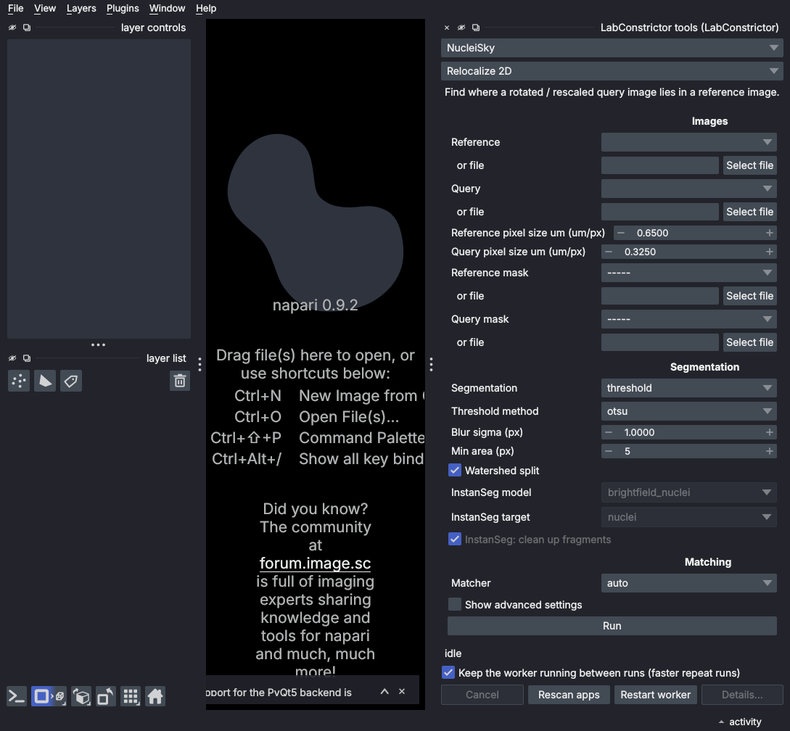
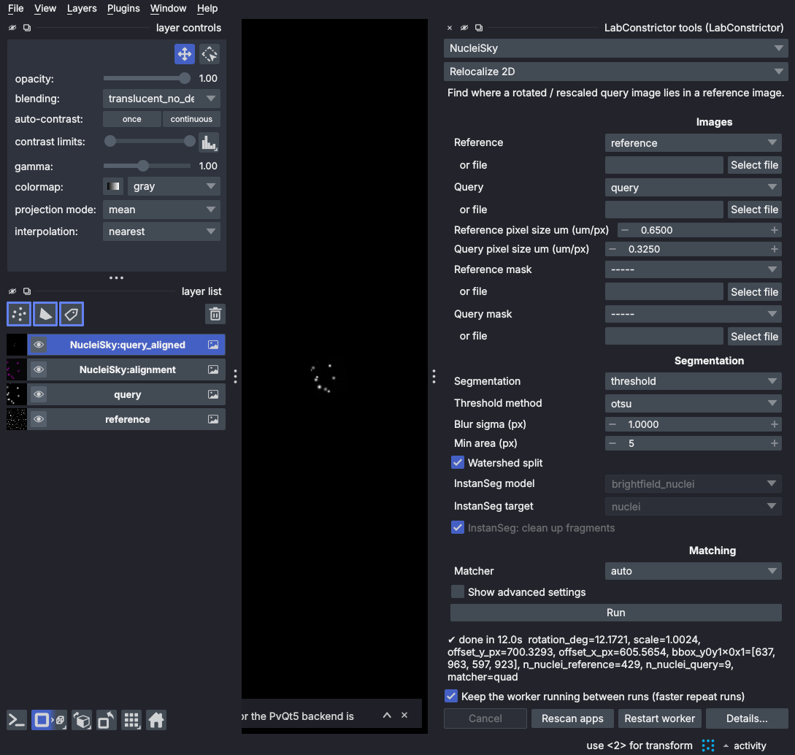
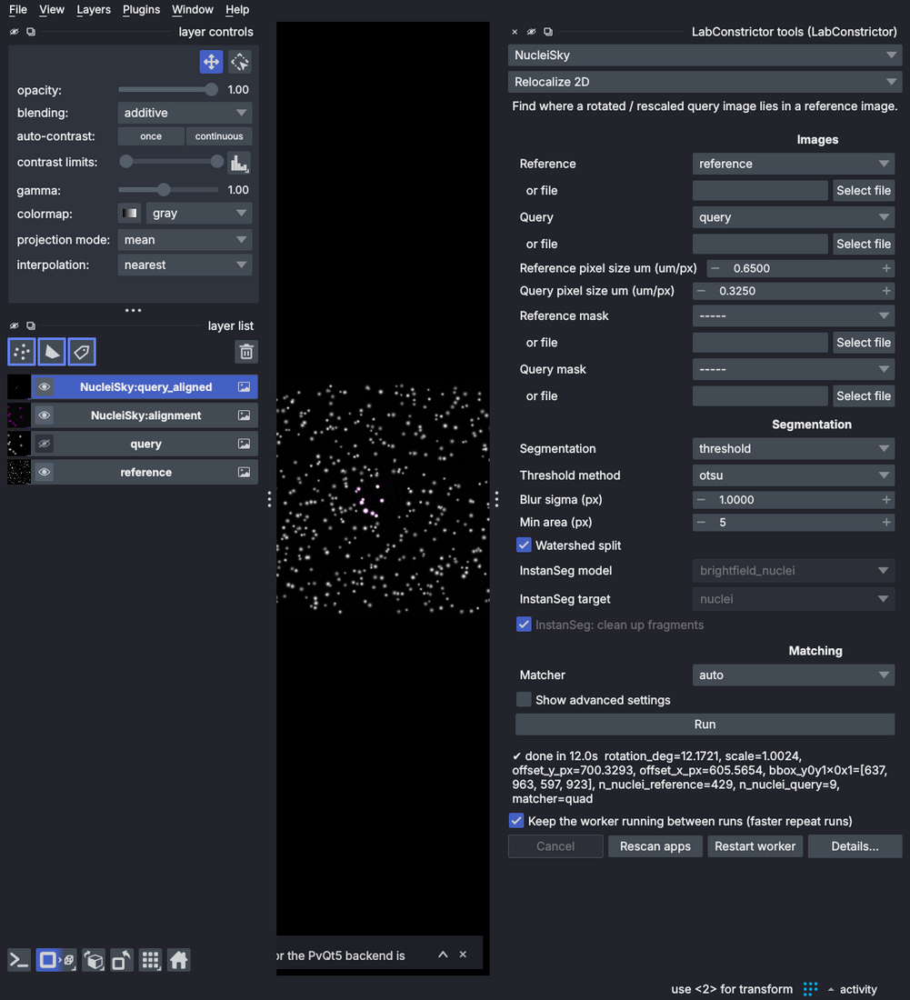
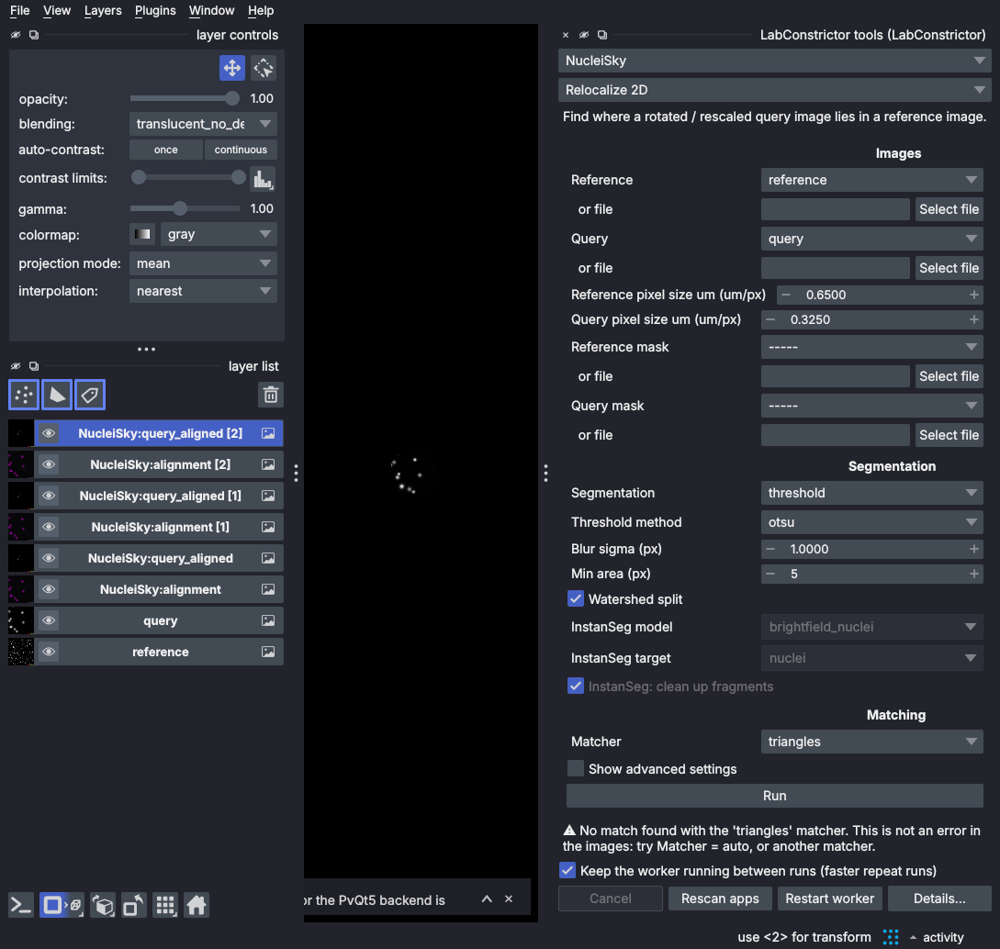
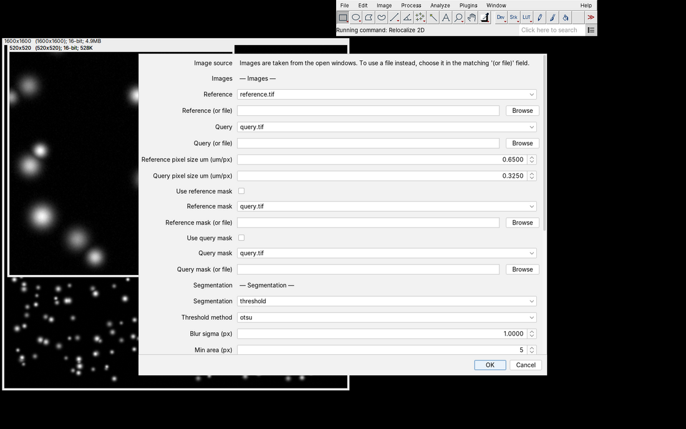
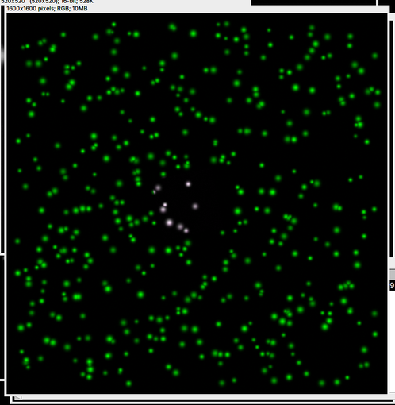
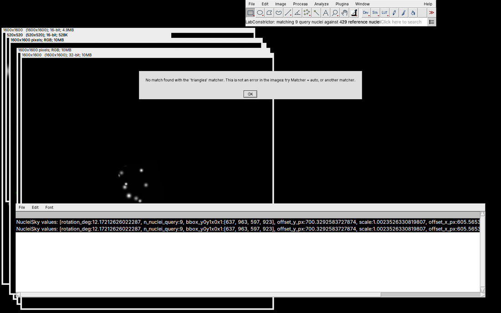
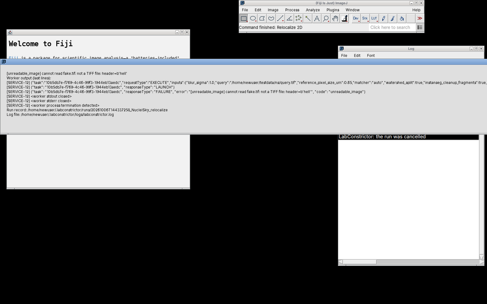

# Human tests: NucleiSky (Napari, Fiji, QuPath)

Part of the [human test protocol](../HUMAN_TEST_PROTOCOL.md): fill in its record sheet first, install NucleiSky and the host(s) as it says.
NucleiSky aligns a small image (the *query*) inside a large one (the *reference*) by matching nuclei. **Discovery:** listed in Napari, Fiji and QuPath.
Registered name `NucleiSky`; tools: **List the devices** (a helper: it fills the `device` drop-down) and **Relocalize 2D** (tool id `relocalize`).
How the hosts show the helper tool in their tool lists: not verified (write down what you see).

**Values.** The pass limits are the ones of the app's own cases (`lc_tests/cases.json` in the NucleiSky repository: rotation 12.0 +/- 1, scale 1.0 +/- 0.05,
offset_y 700.06 +/- 4, offset_x 606.1 +/- 4; counts 429 reference / 9 query, 393 with the masks of NS-N10 are the earlier run's numbers).
Longer numbers given below come from an earlier Linux run with NucleiSky 0.1.1 and may differ in the last digits. Screenshots in this file are of that
older version: **today the two pixel-size fields start empty** (these files carry no calibration and the app has no default), so you type 0.65 and 0.325; the screenshots show them prefilled.

## NS-0. Test data (5 minutes)
Use the Python of the installed NucleiSky (it has numpy, scipy and tifffile). `<NS_TAG>` is the NucleiSky release in the record sheet; the script is read from that tag, not from a branch.

**Linux/macOS (terminal):**
```
mkdir testdata
cd testdata
curl -L -O https://raw.githubusercontent.com/CellMigrationLab/NucleiSky/<NS_TAG>/lc_tests/make_fixtures.py
<PREFIX>/bin/python make_fixtures.py ns
echo hello > fake.tif
```
**Windows (PowerShell; type `curl.exe`, not `curl`):**
```
mkdir testdata
cd testdata
curl.exe -L -O https://raw.githubusercontent.com/CellMigrationLab/NucleiSky/<NS_TAG>/lc_tests/make_fixtures.py
& "<PREFIX>\python.exe" make_fixtures.py ns
"hello" | Out-File -Encoding ascii fake.tif
```
(Whether the file is reachable under the release tag of every NucleiSky release: not verified; it exists on `main`.) `fake.tif` is a text file that pretends to be an image.
Write down the full path of `testdata`: **`<TESTDATA>`** below.

**Expect:** the folder `ns` holds `reference.tif` (about 5 MB), `query.tif`, `reference_mask.tif`, `query_mask.tif`, `ground_truth.json` and a few more masks used by automated tests (ignore them); the last line printed is `ok (1600, 1600) (520, 520)`.

- [ ] PASS  - [ ] FAIL  - [ ] N/A   Notes: ______________________________

## NS-C. Command line (optional)
**Do:** `<APP_PY> -m labconstrictor_tools run NucleiSky relocalize reference=<TESTDATA>/ns/reference.tif query=<TESTDATA>/ns/query.tif reference_pixel_size_um=0.65 query_pixel_size_um=0.325` (Windows: backslashes and `& "<PREFIX>\python.exe"`).
**Expect:** `"status": "COMPLETE"` with `rotation_deg` near 12 and `scale` near 1.0. Without the two pixel-size arguments: `"status": "FAILED"`, `"code": "missing_parameter"` and a sentence that says the images have no calibration. With `reference=<TESTDATA>/fake.tif`: `FAILED`, `unreadable_image`, `cannot read fake.tif: not a TIFF file`.

- [ ] PASS  - [ ] FAIL  - [ ] N/A   Notes: ______________________________

---

## Napari

### NS-N1. The app and its tools are listed
**Do:** `Plugins > LabConstrictor tools`, open the first drop-down, choose NucleiSky, open the second.
**Expect:** the dock opens at the right; `NucleiSky` is in the first drop-down; the tools of the app are in the second (`Relocalize 2D`, and probably `List the devices`). Buttons **Run**, **Cancel** (greyed), **Rescan apps**, **Restart worker**, **Details...** (greyed) and the box *Keep the worker running between runs (faster repeat runs)*.

- [ ] PASS  - [ ] FAIL  - [ ] N/A   Notes (tools you see): ______________________________

### NS-N2. The form
**Do:** choose tool `Relocalize 2D`.
**Expect:** a description line; bold headings **Images**, **Segmentation**, **Matching** in that order and a box **Show advanced settings** (unticked). Under *Images*: *Reference* and *Query* (a layer drop-down and a row *or file* with *Select file*), the two pixel-size fields (*Reference pixel size um (um/px)*, *Query pixel size um (um/px)*, **empty** because no layer is chosen yet), *Reference mask*, *Query mask*. Under *Segmentation*: *Segmentation* = threshold, *Threshold method* = otsu, *Blur sigma (px)* = 1.0, *Min area (px)* = 5, *Watershed split* ticked, then the *InstanSeg* fields greyed. Under *Matching*: *Matcher* = auto.

- [ ] PASS  - [ ] FAIL  - [ ] N/A   Notes: ______________________________



### NS-N3. Open the test images; the pixel sizes are yours to type
**Do:** `File > Open File(s)...`, open `<TESTDATA>/ns/reference.tif` and `query.tif`. Set *Reference* = `reference`, *Query* = `query`. Press **Run** without typing anything.
**Expect:** the pixel-size fields stay empty (the files carry no calibration) and **Run is refused with a message that asks for the pixel size** (nothing is guessed). Now type 0.65 (reference) and 0.325 (query).

- [ ] PASS  - [ ] FAIL  - [ ] N/A   Notes (exact message): ______________________________

### NS-N4. Run with default settings
**Do:** press **Run**. (The first run after installation can take up to 2 minutes while code is compiled; later a run in a new worker takes about 10 to 20 s and one in a kept worker about 2 s.)
**Expect:** progress messages (`segmenting nuclei`, then `matching 9 query nuclei against 429 reference nuclei`) and a moving bar; then `✔ done in <n>s  rotation_deg=12.17..., scale=1.00..., offset_y_px=700..., offset_x_px=605..., ..., n_nuclei_reference=429, n_nuclei_query=9, matcher=quad`. Two new layers `NucleiSky:alignment` and `NucleiSky:query_aligned`; Run usable again, **Details...** enabled. Pass: rotation 11.0 to 13.0, scale 0.95 to 1.05, offsets within 4 px of 700.06 / 606.1.

- [ ] PASS  - [ ] FAIL  - [ ] N/A   Notes (numbers you saw): ______________________________



### NS-N5. The result is placed correctly
**Do:** hide `reference` and `query`; show `NucleiSky:query_aligned` over `reference` (blending `additive` if needed), zoom to the bright cluster.
**Expect:** a small bright patch inside the large field whose nuclei sit on the reference's nuclei (no obvious shift or rotation).

- [ ] PASS  - [ ] FAIL  - [ ] N/A   Notes: ______________________________



### NS-N6. Choose the matcher; "no match" is a notice
**Do:** *Matcher* = `quad`, run; `hashing`, run; `triangles`, run.
**Expect:** `quad` and `hashing`: `✔ done`, rotation about 12, `matcher=quad` / `matcher=hashing`. `triangles` (and `graph`): **`⚠ No match found with the 'triangles' matcher. This is not an error in the images: try Matcher = auto, or another matcher.`**: correct for these images; a notice (⚠), not an error (✖); Run works again.

- [ ] PASS  - [ ] FAIL  - [ ] N/A   Notes: ______________________________



### NS-N7. Files instead of layers
**Do:** *Matcher* back to `auto`. With *Select file* (under *or file*) choose `ns/reference.tif` and `ns/query.tif`. Run. (Pixel sizes: type them again if they are empty.)
**Expect:** the layer drop-down above a chosen file is greyed (the file wins); same numbers as NS-N4.

- [ ] PASS  - [ ] FAIL  - [ ] N/A   Notes: ______________________________

### NS-N8. Settings that do not apply are greyed out
**Do:** clear the *or file* rows. *Segmentation* = `instanseg` (do **not** run).
**Expect:** *Threshold method*, *Blur sigma*, *Min area*, *Watershed split* grey out, the three *InstanSeg* fields become usable; back to `threshold` reverses it.

- [ ] PASS  - [ ] FAIL  - [ ] N/A   Notes: ______________________________

### NS-N9. Other segmentation settings (optional; internet; a Cellpose run takes from about 3 minutes with 4 CPU cores to 20 minutes or more without a GPU)
**Do:** *Threshold method* = `li`, *Min area* = 80, run. Then *Segmentation* = `cellpose`, run.
**Expect:** the `li` run completes with `n_nuclei_reference` close to 425 and `n_nuclei_query=9`. Cellpose is slow (the first time it downloads a model of about 1 GB); about 347 reference nuclei and a rotation near 12; or, if the download is blocked, a message `segmentation_unavailable ... the first run needs internet`, never a frozen window. (InstanSeg finds no nuclei in these synthetic images: do not report that.)

- [ ] PASS  - [ ] FAIL  - [ ] N/A   Notes: ______________________________

### NS-N10. Advanced settings, "set" boxes and masks
**Do:** tick **Show advanced settings**: group **Fine-tuning** appears with *Peak distance (px)* = 5, *Fixed seed*, *Time limit (s)*, the last two with an unticked **set** box and a greyed field. Tick **set** under *Fixed seed* (3) and *Time limit* (60); run; untick both; run. Then in *Reference mask* choose `ns/reference_mask.tif` (and *Query mask* `query_mask.tif`); run. Finally *Reference mask* = `ns/query_mask.tif` (wrong size); run.
**Expect:** the seed/limit runs give the same result as NS-N4 (an unset value must not behave like 0). The mask runs complete with `n_nuclei_query=9`, reference count about 393, rotation near 12. The wrong-size mask: `✖ [mask_shape_mismatch] Reference mask must have the same size as its image: mask (520, 520), image (1600, 1600) ...` within seconds, Run usable again.

- [ ] PASS  - [ ] FAIL  - [ ] N/A   Notes: ______________________________

### NS-N11. Cancel
**Do:** clear the masks. Press **Run**, then **Cancel** while the status says `segmenting nuclei` (about 3 s). Run again, press **Cancel** when it says `matching 9 query nuclei ...`.
**Expect:** first `cancelled`; second `cancelled (worker stopped)` within about 5 s (the matching does not check for Cancel, its process is stopped). Run usable both times; a normal run completes afterwards.

- [ ] PASS  - [ ] FAIL  - [ ] N/A   Notes: ______________________________

### NS-N12. An error you can understand
**Do:** in *Reference* choose the file `testdata/fake.tif`; *Query* = `query`; Run; press **Details...**.
**Expect:** `✖ [unreadable_image] cannot read fake.tif: not a TIFF file: header=b'hell'  - click Details... for the full report (log: ...)`. Details shows the error, worker output, run record location and log path.

- [ ] PASS  - [ ] FAIL  - [ ] N/A   Notes: ______________________________

### NS-N13. Damaged and unusual files
**Do:** use as *Reference* file: (b) a cut TIFF (Linux/macOS `head -c 3000000 <TESTDATA>/ns/reference.tif > <TESTDATA>/short.tif`; Windows PowerShell `$b=[IO.File]::ReadAllBytes("<TESTDATA>\ns\reference.tif"); [IO.File]::WriteAllBytes("<TESTDATA>\short.tif",$b[0..2999999])`); (c) `query.tif` copied into a folder `test é 日本` (a path with spaces and non-English letters; this is about files, not the install path).
**Expect:** (b) `✖ [unreadable_image] cannot read short.tif: failed to read ... bytes, got ...`; (c) the run works as with the normal path.

- [ ] PASS  - [ ] FAIL  - [ ] N/A   Notes: ______________________________

### NS-N14. Faster second run
**Do:** NucleiSky, `Relocalize 2D`, layers `reference`/`query`, pixel sizes typed, *Matcher* auto, *Keep the worker running* ticked. **Restart worker**, then **Run** three times. Then untick the box and run twice.
**Expect:** first run after restart the longest (10 to 20 s; up to 2 min if the first since installation), the next two about 2 s. Unticked: both about as long as the first.

- [ ] PASS  - [ ] FAIL  - [ ] N/A   Notes (times): ______________________________

---

## Fiji
(Set-up and the Fiji limits: F0 of the protocol.)

### NS-F1. Choose app and tool
**Do:** open `ns/reference.tif` first and then `ns/query.tif` (the first open image is offered as the reference). Start **Plugins > LabConstrictor > LabConstrictor Tools...**.
**Expect:** a dialog *LabConstrictor* with *Application* listing the apps allowed in Fiji (pick `NucleiSky`, OK; with one usable app the dialog is skipped). Then a tool chooser if the app shows more than one tool (not verified how the helper is shown), and the tool form titled *Relocalize 2D*.

- [ ] PASS  - [ ] FAIL  - [ ] N/A   Notes: ______________________________

### NS-F2. The form and the pixel-size limit
**Expect (form):** a note *Images are taken from the open windows...*; headings **— Images —**, **— Segmentation —**, **— Matching —**, **— Advanced settings —**, **— Fine-tuning —**; *Reference* and *Query* preselected with the two open images (reference = the big 1600 x 1600 one); *Reference (or file)* / *Query (or file)*; the two pixel-size fields; *Use reference mask* / *Use query mask*; segmentation fields; *Matcher*; *Peak distance (px)*; **Set fixed seed**, **Set time limit**. Fields that do not apply are **not** greyed (known).
**Do:** the pixel-size fields are **empty/0** (no calibration, nothing guessed). Press OK with them empty.
**Expect:** the run is **refused** with a message (`... needs a value ... Enter it in um.`) and the Log says `not calibrated: ...has no pixel size`. Then type 0.65 and 0.325. (Fiji limit: typing a value the box already shows is not seen as an edit: if you type exactly what a field shows, the field is cleared and the run blocked: record it, it is not a bug.)

- [ ] PASS  - [ ] FAIL  - [ ] N/A   Notes: ______________________________



### NS-F3. Run with defaults
**Do:** with 0.65 and 0.325 typed, press OK.
**Expect:** progress in the status line, then a window **NucleiSky:query_aligned**, a window **Alignment overlay (green = reference, magenta = query)**, and in the **Log** a line `NucleiSky values: [rotation_deg:12.17..., ...` with `n_nuclei_reference:429`, `n_nuclei_query:9`, `matcher:quad`. Same pass limits as NS-N4.

- [ ] PASS  - [ ] FAIL  - [ ] N/A   Notes (numbers): ______________________________



### NS-F4. Matcher choice and "no match"
**Do:** run with *Matcher* = `hashing`, then `triangles`.
**Expect:** `hashing` works. `triangles` shows a plain **message** window (information style) `No match found with the 'triangles' matcher. This is not an error in the images: try Matcher = auto, or another matcher.`

- [ ] PASS  - [ ] FAIL  - [ ] N/A   Notes: ______________________________



### NS-F5. Unset values and files
**Do:** run with **Set fixed seed** (3) and **Set time limit** (60), then without. Then `Window > Close All` and start the plugin: file choosers *Reference*, *Query* and masks appear instead of image selectors; choose the two files; run.
**Expect:** same result as NS-F3 each time.

- [ ] PASS  - [ ] FAIL  - [ ] N/A   Notes: ______________________________

### NS-F6. Cancel and an error
**Do:** run and press **Esc** while the bar moves (click Fiji's main window first; start about 3 s after OK; a run takes about 12 s). Then, with no image open, choose `testdata/fake.tif` as *Reference (or file)*.
**Expect:** Esc: the run stops within seconds, no result windows, the Log says `LabConstrictor: the run was cancelled`, the next run works. Error: a window `LabConstrictor: NucleiSky` with `[unreadable_image] cannot read fake.tif: not a TIFF file ...` naming the log file, no Java stack trace (if the window is wider than your screen close it with Alt+F4 / Cmd+W and note the screen size).

- [ ] PASS  - [ ] FAIL  - [ ] N/A   Notes: ______________________________



### NS-F7. Macro line typed by hand (jar install only)
The Macro Recorder does **not** record this plugin yet; do not use it. **Do:** open the two images, `Plugins > Macros > New...`, run:
`run("LabConstrictor Tools...", "app=NucleiSky tool=[Relocalize 2D] reference=reference.tif query=query.tif reference_pixel_size_um=0.65 query_pixel_size_um=0.325 segmentation=threshold");`
then again with `tool=[No such tool]`.
**Expect:** the first gives the NS-F3 result with no dialog; the second a message listing the valid tools.

- [ ] PASS  - [ ] FAIL  - [ ] N/A   Notes: ______________________________

---

## QuPath
(Set-up: Q0 of the protocol. Not verified by a person on any system: write down every deviation.) Open any image in QuPath (or none: the form accepts files).

### NS-Q1. Listed, form
**Do:** `Extensions > LabConstrictor tools...`, choose `NucleiSky` and `Relocalize 2D`.
**Expect:** a form built from the declaration: group headings, *Reference* / *Query* choosers (the image open in QuPath, an image of the project, or a file), the two pixel-size fields, the mask fields, advanced settings in a collapsed section, optional values with a **set** box. Fields that do not apply are greyed (QuPath greys `EnabledWhen`).

- [ ] PASS  - [ ] FAIL  - [ ] N/A   Notes: ______________________________

### NS-Q2. Run with files
**Do:** choose the files `ns/reference.tif` and `ns/query.tif` for the two images. Leave the pixel sizes empty and run; then type 0.65 and 0.325 and run.
**Expect:** the first is refused with a message asking for the pixel size (files have no calibration); the second completes. The results window shows the values (`rotation_deg` near 12, `scale` near 1.0, `n_nuclei_reference` 429, `n_nuclei_query` 9), the alignment (a matrix), and the nuclei tables/outlines the app returns (what exactly QuPath draws for outlines of an image that is not open: "Not placed on an image (...)" is the documented outcome, not an error).

- [ ] PASS  - [ ] FAIL  - [ ] N/A   Notes: ______________________________

### NS-Q3. No match is a message
**Do:** *Matcher* = `triangles`; run.
**Expect:** a message ("No match found with the 'triangles' matcher ...") under the status line and in the results, not a red error.

- [ ] PASS  - [ ] FAIL  - [ ] N/A   Notes: ______________________________

### NS-Q4. An error you can understand; Cancel
**Do:** choose `testdata/fake.tif` as *Reference*; run; press **Details**. Then start a normal run and press **Cancel** during segmentation.
**Expect:** a sentence naming the unreadable file (`unreadable_image`, not a TIFF file); Details shows the run record. Cancel stops the run and the form is usable again; no worker is left behind when the window is closed (check the process list).

- [ ] PASS  - [ ] FAIL  - [ ] N/A   Notes: ______________________________
